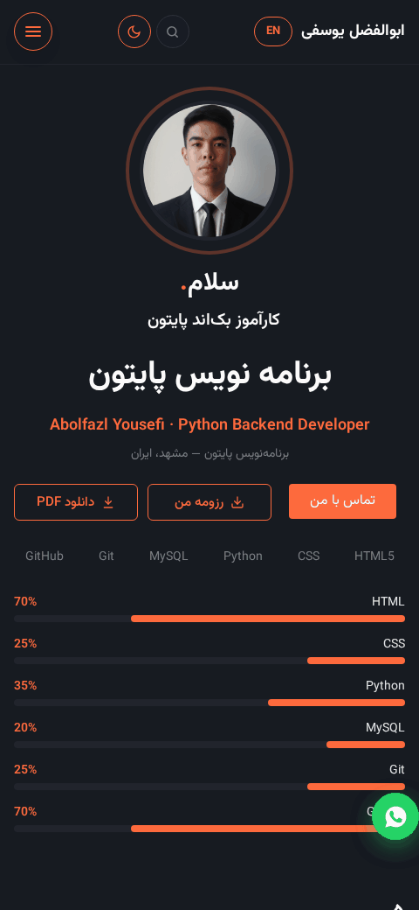

<div dir="rtl" align="right">

# وب‌سایت شخصی ابوالفضل یوسفی

نسخه‌ی زنده‌ی وب‌سایت برای معرفی من، مهارت‌ها و پروژه‌هایم:

**[مشاهده‌ی وب‌سایت](https://abolfazl-yousefi.is-a.dev/)**

این مخزن `CV` نسخه‌ی قبلی وب‌سایت را نگه می‌دارد؛ سایت زنده از آن نسخه به تجربه‌ای کامل‌تر و دوزبانه ارتقا پیدا کرده است.

</div>

---

## پیش‌نمایش متحرک



این GIF از صفحه‌ی زنده‌ی سایت ضبط شده است.

برای نمایش در GitHub، فایل GIF را کنار این README در مسیر `assets/site-preview.gif` قرار دهید.

---

## درباره‌ی سایت

این وب‌سایت یک پورتفولیوی شخصی است.

هدفش معرفی کوتاه صاحب سایت و نمونه‌کارهای اوست.

نسخه‌ی عمومی سایت از طریق لینک بالای صفحه در دسترس است.

صفحه‌ها برای نمایش موبایل و دسکتاپ طراحی شده‌اند.

رابط کاربری فارسی و انگلیسی دارد.

صفحه‌ی فارسی راست‌چین است.

صفحه‌ی انگلیسی چپ‌چین است.

---

## امکانات اصلی

- صفحه‌ی اصلی برای معرفی و دسترسی سریع به بخش‌ها.
- بخش درباره‌من و معرفی مهارت‌ها.
- فهرست پروژه‌ها با لینک مخزن اختصاصی هر پروژه.
- صفحه‌های جداگانه‌ی فارسی و انگلیسی.
- رزومه‌ی فارسی در قالب صفحه‌ی وب و PDF.
- رزومه‌ی انگلیسی در قالب صفحه‌ی وب و PDF جداگانه.
- پیمایش سازگار با صفحه‌نمایش موبایل.
- انتخاب ظاهر روشن یا تیره در رابط کاربری.
- لینک‌های ارتباطی و شبکه‌های اجتماعی.
- طراحی با رنگ شاخص نارنجی و زمینه‌ی تیره.

---

## صفحه‌ها

| نشانی | توضیح |
|---|---|
| [صفحه‌ی اصلی فارسی](https://abolfazl-yousefi.is-a.dev/) | معرفی، مهارت‌ها و دسترسی به بخش‌های سایت |
| [صفحه‌ی اصلی انگلیسی](https://abolfazl-yousefi.is-a.dev/en-index.html) | نسخه‌ی انگلیسی صفحه‌ی اصلی |
| [درباره‌من](https://abolfazl-yousefi.is-a.dev/about.html) | اطلاعات معرفی و راه‌های ارتباط |
| [پروژه‌ها](https://abolfazl-yousefi.is-a.dev/projects.html) | فهرست پروژه‌ها |
| [بلاگ](https://abolfazl-yousefi.is-a.dev/blog.html) | نوشته‌ها و مطالب سایت |
| [رزومه‌ی فارسی](https://abolfazl-yousefi.is-a.dev/resume.html) | نسخه‌ی فارسی رزومه |
| [رزومه‌ی انگلیسی](https://abolfazl-yousefi.is-a.dev/en-resume.html) | نسخه‌ی انگلیسی رزومه |

---

## زبان‌ها و جهت نوشتار

زبان اصلی سایت فارسی است.

نسخه‌ی انگلیسی از صفحه‌های جداگانه استفاده می‌کند.

جهت صفحه‌ی فارسی `RTL` است.

جهت صفحه‌ی انگلیسی `LTR` است.

متن انگلیسی رزومه چپ‌چین نمایش داده می‌شود.

پیوندهای زبان در صفحه‌ها امکان جابه‌جایی بین دو نسخه را می‌دهند.

---

## رزومه‌ها

رزومه‌ی فارسی در نشانی زیر قرار دارد:

- صفحه‌ی وب: [resume.html](https://abolfazl-yousefi.is-a.dev/resume.html)
- فایل PDF: [resume.pdf](https://abolfazl-yousefi.is-a.dev/resume.pdf)

رزومه‌ی انگلیسی در نشانی زیر قرار دارد:

- صفحه‌ی وب: [en-resume.html](https://abolfazl-yousefi.is-a.dev/en-resume.html)
- فایل PDF: [en-resume.pdf](https://abolfazl-yousefi.is-a.dev/en-resume.pdf)

فایل PDF انگلیسی مستقل از PDF فارسی است.

هر دو لینک دانلود در نسخه‌ی زنده بررسی شده‌اند.

---

## پروژه‌های نمایش‌داده‌شده

هر کارت پروژه به مخزن همان پروژه در GitHub پیوند می‌دهد.

| پروژه | مخزن |
|---|---|
| وب‌سایت رزومه و پورتفولیو | [Portfolio](https://github.com/abolfazlyousefi5/Portfolio) |
| شبیه‌ساز مدیریت بانک | [Bank-App](https://github.com/abolfazlyousefi5/Bank-App) |
| تولیدکننده‌ی رمز تصادفی | [password-generator](https://github.com/abolfazlyousefi5/password-generator) |
| تایمر پایتون | [python-timer](https://github.com/abolfazlyousefi5/python-timer) |
| ابزار رمزگذاری و رمزگشایی | [mini-encrypt-decrypt](https://github.com/abolfazlyousefi5/mini-encrypt-decrypt) |
| بازی سنگ، کاغذ، قیچی | [rock-paper-scissors-game](https://github.com/abolfazlyousefi5/rock-paper-scissors-game) |

---

## فناوری‌ها

- HTML برای ساختار صفحه‌ها.
- CSS برای چیدمان و ظاهر.
- JavaScript برای رفتارهای تعاملی رابط کاربری.
- SVG برای برخی از آیکن‌ها.

این مخزن شامل نسخه‌ی قبلی فایل‌های سایت در پوشه‌ی `port/` است.

نسخه‌ی زنده‌ی جدید از لینک عمومی بالای README قابل مشاهده است.

---

## ساختار مخزن فعلی

در نسخه‌ی عمومی مخزن `CV`، فایل‌های قدیمی سایت داخل پوشه‌ی `port/` قرار دارند.

```text
CV/
├── README.md
└── port/
    ├── index.html
    ├── script.js
    ├── style.css
    ├── tailwind.config.js
    ├── assets/
    │   └── resume.pdf
    └── img/
        └── 11zon_cropped.png
```

فایل GIF پیش‌نمایش این README باید در مسیر زیر افزوده شود:

```text
assets/site-preview.gif
```

این مسیر در ریشه‌ی مخزن است، کنار `README.md`.

---

## اجرای نسخه‌ی مخزن روی رایانه

این مراحل نسخه‌ی موجود در مخزن را اجرا می‌کنند.

آن‌ها نسخه‌ی زنده‌ی جدید را روی اینترنت تغییر نمی‌دهند.

ابتدا مخزن را دریافت کنید:

```bash
git clone https://github.com/abolfazlyousefi5/CV.git
```

وارد پوشه‌ی مخزن شوید:

```bash
cd CV
```

به پوشه‌ی نسخه‌ی قبلی سایت بروید:

```bash
cd port
```

یک وب‌سرور ساده‌ی محلی اجرا کنید:

```bash
python -m http.server 8000
```

سپس این نشانی را در مرورگر باز کنید:

```text
http://localhost:8000
```

برای توقف وب‌سرور، در پنجره‌ی ترمینال `Ctrl+C` را بزنید.

---

## افزودن GIF به مخزن

فایل GIF آماده در پوشه‌ی `assets/` همین بسته قرار دارد.

نام فایل را `site-preview.gif` نگه دارید.

در مخزن GitHub یک پوشه‌ی `assets` در ریشه بسازید، اگر وجود ندارد.

فایل را در همان پوشه بارگذاری کنید.

مسیر نهایی باید این باشد:

```text
CV/assets/site-preview.gif
```

README همین مسیر نسبی را برای پیش‌نمایش به‌کار می‌برد.

پس از Commit، GitHub باید تصویر متحرک را در صفحه‌ی README نشان دهد.

---

## نگهداری محتوا

- لینک هر پروژه را پیش از افزودن، در GitHub باز کنید.
- مهارت‌ها و توضیحات را فقط بر اساس اطلاعات واقعی به‌روز کنید.
- لینک رزومه‌های فارسی و انگلیسی را پس از تعویض PDF آزمایش کنید.
- پیش از انتشار، صفحه‌های فارسی و انگلیسی را در موبایل بازبینی کنید.

---

## انتشار و بررسی

نسخه‌ی زنده از این دامنه قابل مشاهده است:

`https://abolfazl-yousefi.is-a.dev/`

پس از هر به‌روزرسانی، لینک‌های صفحه‌ی اصلی را باز کنید.

لینک صفحه‌ی فارسی و انگلیسی را جداگانه بررسی کنید.

لینک فایل‌های PDF را در مرورگر آزمایش کنید.

برای آزمون موبایل، عرض صفحه را کوچک کنید و منو را باز کنید.

این README به‌تنهایی فایل‌های سایت زنده را به‌روزرسانی نمی‌کند.

---

## ارتباط

برای دیدن اطلاعات تماس به بخش تماس وب‌سایت بروید.

نشانی سایت: [abolfazl-yousefi.is-a.dev](https://abolfazl-yousefi.is-a.dev/)

پروفایل GitHub: [abolfazlyousefi5](https://github.com/abolfazlyousefi5)

---

## English summary

This repository contains the earlier version of Abolfazl Yousefi’s personal website.

The refreshed public website is available at [abolfazl-yousefi.is-a.dev](https://abolfazl-yousefi.is-a.dev/).

The live site includes Persian and English pages, project links, and separate résumé PDFs.

A mobile preview GIF is included at `assets/site-preview.gif`.

The `port/` directory contains the previous static website files.

Run the previous version locally with Python’s built-in HTTP server from that directory.

---

<div align="center">

ساخته‌شده برای معرفی بهتر مهارت‌ها و پروژه‌ها.

</div>
